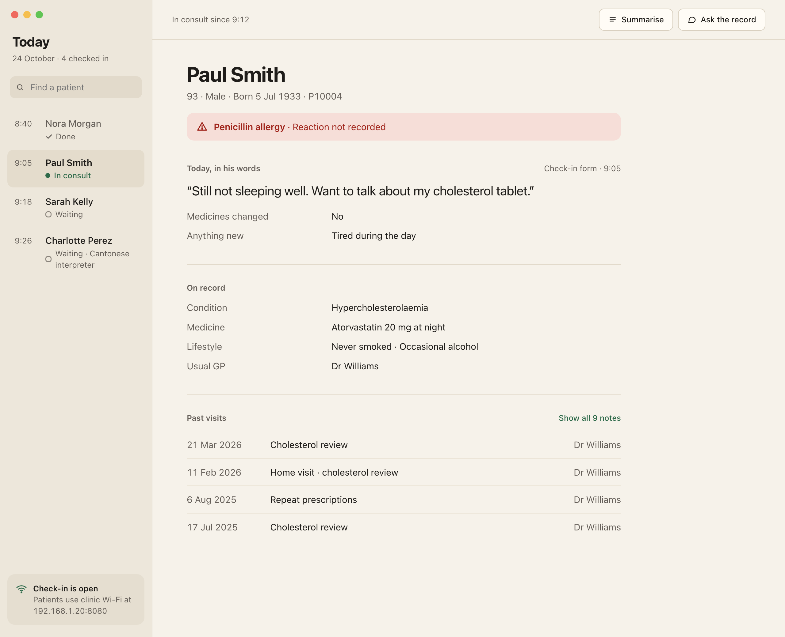
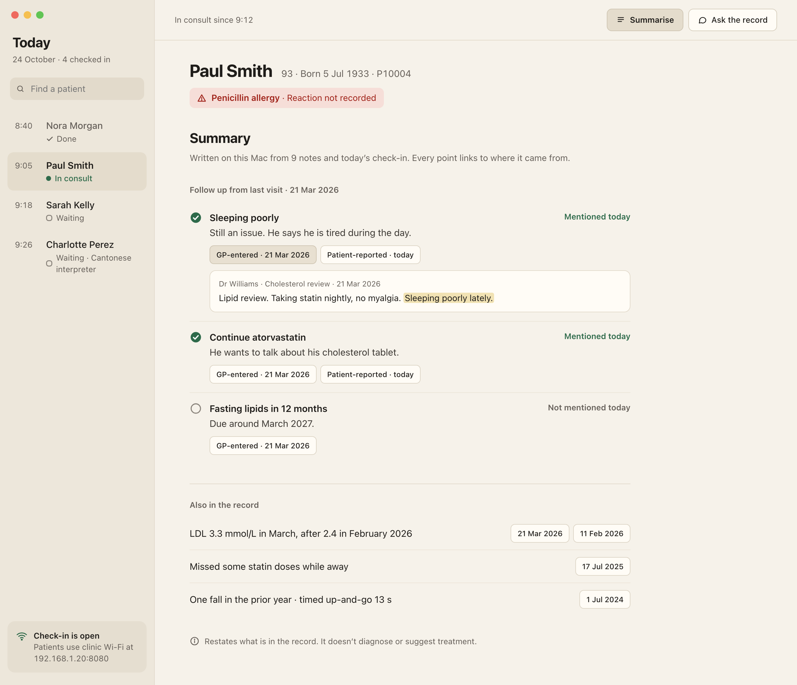
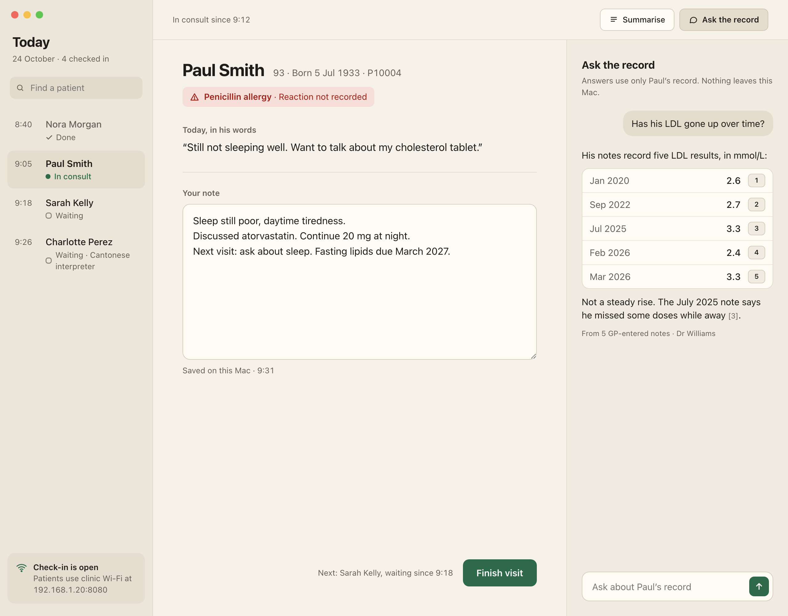
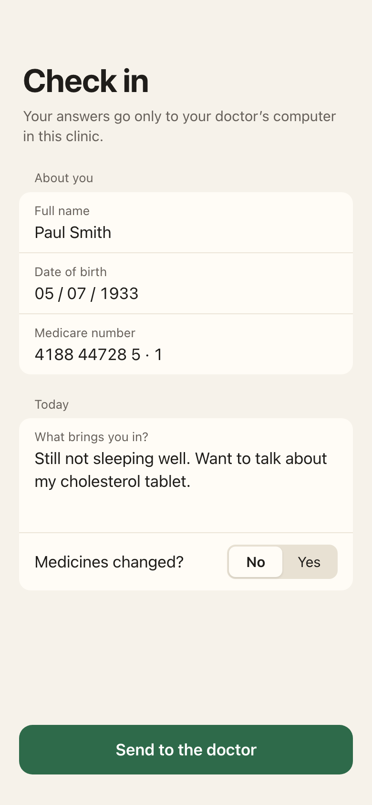
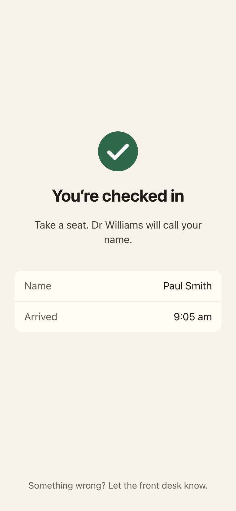

# Steady Care — cream design direction

Design target for the GPInTheBox Mac app and the patient check-in form. Static mockups, not implemented yet.

Principle: **patient first, one job per screen.** Each screen has at most one prominent button. Clinical content beats software labels.

## Screens

| | |
|---|---|
|  | **1 · Patient brief.** Queue in the sidebar. Patient identity, allergy, today's check-in answers, what's on record, recent visits. |
|  | **2 · Summary (after the GP presses Summarise).** Follow-ups from the last visit, each matched to today's check-in as *Mentioned today* / *Not mentioned today*. Every point has source chips labelled **GP-entered** or **Patient-reported**; one is expanded to show the source sentence with the matched words highlighted. |
|  | **3 · Ask the record + note.** Q&A inspector answers from the record only, with numbered sources. GP note on the left, *Finish visit* is the one primary action. |
|  | **4 · Check-in form (patient's phone, LAN web form).** Grouped fields, one primary button. |
|  | **5 · Checked in.** Confirmation and what happens next. |

Each PNG has a matching `.html` in `screens/` (plain HTML, inline styles, no build step). The phone screens double as a starting point for the intake form's HTML/CSS.

## Tokens

| Role | Hex | Notes |
|---|---|---|
| Background | `#F6F2EA` | Cream window content |
| Sidebar | `#EDE7DB` | |
| Selected row / pressed toolbar button | `#E4DCCC` | |
| Surface (fields, quotes, chips) | `#FFFCF6` | |
| Hairline | `#E2DACB` (section), `#ECE5D8` (row) | |
| Text | `#1F1D1A` | |
| Secondary text | `#66605A` | ≥4.5:1 on background and sidebar |
| Accent (primary button, "In consult", "Mentioned today") | `#2E6A4A` | White text on it |
| Allergy text / background | `#9F2219` / `#F6DED8` | Always with the warning icon |
| Source highlight | `#F1E2B3` | |

Type: system font (SF Pro). Mac body 15, section labels 13 semibold secondary, patient name 34 (28 on sub-screens). iPhone body 17, large title 34. Tabular numerals for times, dates and results. Sentence case everywhere.

Spacing: 8-pt rhythm. Corner radius 8 (buttons), 10–12 (rows, fields, banners), 14 (phone primary button).

## SwiftUI mapping

| Mockup | SwiftUI |
|---|---|
| Sidebar queue + content | `NavigationSplitView`, `List(selection:)` with `.listStyle(.sidebar)` |
| Summarise / Ask the record | `ToolbarItem`s; Ask toggles `.inspector(isPresented:)` |
| Section labels + label/value rows | `Grid` or `LabeledContent`, not cards |
| Allergy banner | `Label(…, systemImage: "exclamationmark.triangle")` on a tinted rounded rectangle |
| Status (Waiting / In consult / Done) | Text + symbol (`circle`, filled dot, `checkmark`) — never colour alone |
| Source chips | Bordered small `Button`s opening a popover with the source sentence |
| Finish visit | `.buttonStyle(.borderedProminent)`, `.tint(accent)`, the only prominent button on screen |
| Colours | One `Color` extension holding the tokens above |

## Rules

- Nothing is generated in the background. Summary and answers appear only after the GP asks.
- Every AI statement carries a source and its origin (GP-entered / Patient-reported, date). Answers restate the record; they don't diagnose.
- Say where data lives in plain words: "Saved on this Mac", "Nothing leaves this Mac", "Your answers go only to your doctor's computer in this clinic".
- Keep off the consult screen: Medicare/IHI numbers, billing, model/hardware labels, connection badges, confidence scores.
- Pair colour with an icon or text. Real buttons, labels and inputs, so keyboard and VoiceOver work.

## Data

Paul Smith (P10004) and his history, allergy, medicine and LDL results come from the synthetic demo data (patients CSV and consultation notes). Today's check-in text, arrival times, the GP note text and the LAN address are illustrative placeholders.

Not yet checked: contrast measured in the built app, Dynamic Type / large text, dark mode, long medicine and allergy lists.
